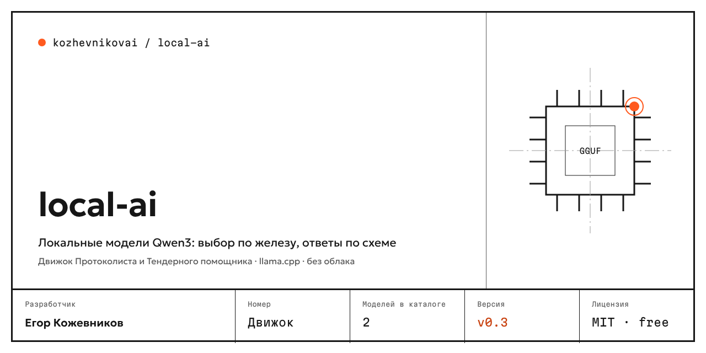
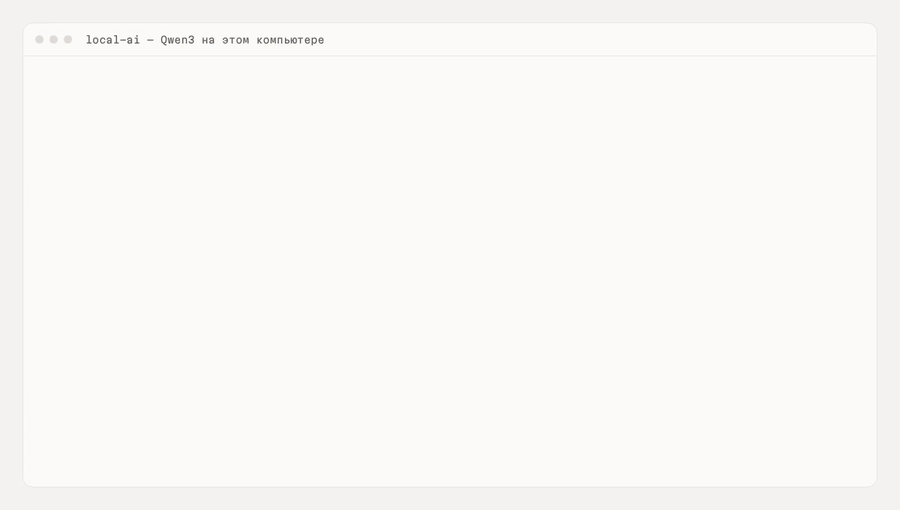

<p align="center"></p>

# local-ai

Local AI model engine behind [Protokolist](https://github.com/kozhevnikovai/protokolist), [Tender Assistant](https://github.com/kozhevnikovai/tender-pomoshnik) and other [kozhevnikovai](https://github.com/kozhevnikovai) products. It picks a model that fits the computer, downloads it and answers by JSON schema. Works offline: the only network traffic is the one-time model download.

[Русский](README.md)



<sub>Recorded in GitHub Actions: 4 cores, 16 GB, no GPU. Long pauses are sped up; the screen shows the real elapsed time.</sub>

## Install in 3 steps

1. Install: `npm install github:kozhevnikovai/local-ai node-llama-cpp`
2. See which model fits: `recommend(await detectHardware())`
3. Download it and ask: `downloadFiles` → `loadLocalLLM` → `llm.json(...)` (full example below)

## Features

- **Two models** — a light one for regular PCs and laptops, a strong one for 16 GB+ PCs or a GPU.
- **Hardware-aware choice** — checks RAM and GPU, recommends a model and explains why; the user can pick another.
- **Reliable download** — resume after a break, free-space check, SHA-256, a fallback mirror if Hugging Face is unreachable.
- **JSON-schema answers** — llama.cpp on CPU or GPU (CUDA, Vulkan, Metal), no "thinking" output, loop protection.
- **Long texts** — `chunkText` splits a multi-hour transcript or a large document by paragraphs and sentences (with overlap), `mapReduce` processes the parts and merges the result.
- **Streaming and Stop** — `onText` returns text as it is generated, `signal` stops the answer; concurrent calls are queued.
- **Model removal** — `removeModel` frees disk space, including a partial download.
- **Windows paths** — if the user name contains Cyrillic, models go to `C:\ProgramData\<App>`.

## Models

| Tier | Model | Size | Needs | License |
|---|---|---|---|---|
| Light | Qwen3 4B Instruct (default) | 2.5 GB | 8 GB RAM | Apache-2.0 |
| Strong | Qwen3 14B (default) | 9.0 GB | 16 GB RAM or 11 GB GPU | Apache-2.0 |

Chosen by meeting-minutes evals (4 meetings, CPU): Qwen3 4B — tasks 100 %, owners and deadlines 88 %; Qwen3 14B — 100 % on every item. Gemma 4 E4B and 12B, GigaChat 3.1 Lightning, T-lite-it 2.1, YandexGPT 5 Lite 8B and Qwen3 8B were tested and fell below the bar. Every catalog model is checked in CI: download, launch, a Russian answer by schema.

## Example

```ts
import { detectHardware, recommend, downloadFiles, loadLocalLLM, appHome, modelsDir, chunkText, mapReduce } from "@kozhevnikovai/local-ai";
import { join } from "node:path";

const dir = modelsDir(appHome("MyApp"), "MyApp");
const { model, reason } = recommend(await detectHardware());
console.log(reason);
await downloadFiles([model.file], { dir, onProgress: e => console.log(e.done, "/", e.total) });
const llm = await loadLocalLLM({ modelFile: join(dir, model.file.path) });
const out = await llm.json("List the tasks", "Ivan, send the report by Friday", { type: "object", properties: { tasks: { type: "array", items: { type: "string" } } }, required: ["tasks"] });
// long text in chunks, streaming answer that can be stopped
const ac = new AbortController();
const parts = chunkText(longTranscript, { maxChars: 12000, overlap: 400 });
const summary = await mapReduce({
  chunks: parts,
  map: c => llm.text("Summarize the fragment", c, 400, { signal: ac.signal }),
  reduce: p => llm.text("Merge the summaries", p.join("\n\n"), 800, { signal: ac.signal, onText: t => process.stdout.write(t) }),
});
await llm.dispose();
```

## FAQ

**Do I need a GPU?** No. The light model runs on a CPU with 8 GB RAM. A GPU makes answers faster.

**How long does an answer take?** Tasks from a short transcript on 4 CPU cores without a GPU: about 20 seconds with the light model and about a minute with the strong one. Loading the model into memory takes 5–15 seconds.

**Why only Qwen3?** We ran eight models on meeting minutes. Only these two passed the bar for tasks, deadlines and quotes.

**What goes over the network?** Only the model file download from Hugging Face or a mirror. Prompts never leave the computer.

## Security

Only https URLs from the catalog are downloaded, a file with a wrong SHA-256 is deleted, model paths never leave the models folder. See [SECURITY.md](SECURITY.md).

## License

MIT. Model weights follow their developers' licenses (see the table).
