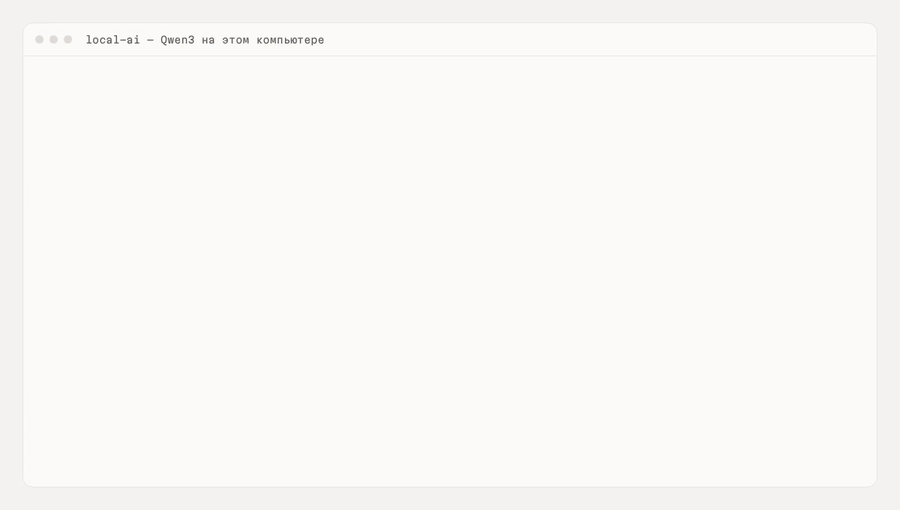

# local-ai

Движок локальных ИИ-моделей для [Протоколиста](https://github.com/kozhevnikovai/protokolist), [Тендерного помощника](https://github.com/kozhevnikovai/tender-pomoshnik) и других продуктов [kozhevnikovai](https://github.com/kozhevnikovai). Подбирает модель под компьютер, скачивает её и отвечает по JSON-схеме. Работает без интернета: в сеть уходит только одна загрузка модели.

[English](README.en.md)



<sub>Запись запуска в GitHub Actions: 4 ядра, 16 ГБ, без видеокарты. Долгие паузы ускорены, на экране видно, сколько прошло на самом деле.</sub>

## Установка за 3 шага

1. Поставьте пакет: `npm install github:kozhevnikovai/local-ai node-llama-cpp`
2. Узнайте, какая модель подойдёт: `recommend(await detectHardware())`
3. Скачайте её и спросите: `downloadFiles` → `loadLocalLLM` → `llm.json(...)` (полный пример ниже)

## Что умеет

- **Две модели на выбор** — «лёгкая» для обычных ПК и ноутбуков, «мощная» для ПК от 16 ГБ или с видеокартой.
- **Выбор по железу** — смотрит оперативную память и видеокарту, рекомендует модель и объясняет почему; пользователь может выбрать другую.
- **Надёжная загрузка** — докачка после обрыва, проверка места на диске, SHA-256, запасное зеркало, если Hugging Face недоступен.
- **Ответы по JSON-схеме** — llama.cpp на процессоре или видеокарте (CUDA, Vulkan, Metal), без «рассуждений» модели, с защитой от зацикливания.
- **Длинные тексты** — `chunkText` режет многочасовую стенограмму или большой документ на части по абзацам и предложениям (с перекрытием), `mapReduce` разбирает части по очереди и сводит итог.
- **Ответ «на лету» и кнопка «Стоп»** — `onText` отдаёт текст по мере генерации, `signal` останавливает ответ; одновременные вызовы встают в очередь.
- **Удаление модели** — `removeModel` освобождает место, включая недокачанный файл.
- **Пути на Windows** — если в имени пользователя кириллица, модели кладутся в `C:\ProgramData\<Программа>`.

## Модели

| Класс | Модель | Размер | Нужно | Лицензия |
|---|---|---|---|---|
| Лёгкая | Qwen3 4B Instruct (по умолчанию) | 2,5 ГБ | от 8 ГБ ОЗУ | Apache-2.0 |
| Мощная | Qwen3 14B (по умолчанию) | 9,0 ГБ | от 16 ГБ ОЗУ или видеокарта 11 ГБ | Apache-2.0 |

Модели выбраны по evals протокола встреч (4 встречи, процессор): Qwen3 4B — задачи 100 %, ответственные и сроки 88 %; Qwen3 14B — 100 % по всем пунктам. Проверены и не вошли: Gemma 4 E4B и 12B, GigaChat 3.1 Lightning, T-lite-it 2.1, YandexGPT 5 Lite 8B, Qwen3 8B — ниже порога по задачам, срокам или цитатам. Каждая модель каталога проверяется в CI: загрузка, запуск, ответ на русском по схеме. Qwen3.5 (4B, 9B) пока не включены: в текущей сборке llama.cpp они не выдают ответ по JSON-схеме — вернёмся после обновления.

## Пример

```ts
import { detectHardware, recommend, downloadFiles, loadLocalLLM, appHome, modelsDir, chunkText, mapReduce } from "@kozhevnikovai/local-ai";
import { join } from "node:path";

const dir = modelsDir(appHome("MyApp"), "MyApp");
const { model, reason } = recommend(await detectHardware());
console.log(reason);
await downloadFiles([model.file], { dir, onProgress: e => console.log(e.done, "/", e.total) });
const llm = await loadLocalLLM({ modelFile: join(dir, model.file.path) });
const out = await llm.json("Выпиши задачи", "Иван, отправь отчёт до пятницы", { type: "object", properties: { tasks: { type: "array", items: { type: "string" } } }, required: ["tasks"] });
// длинный текст по частям, ответ «на лету» с возможностью остановить
const ac = new AbortController();
const parts = chunkText(longTranscript, { maxChars: 12000, overlap: 400 });
const summary = await mapReduce({
  chunks: parts,
  map: c => llm.text("Кратко перескажи фрагмент", c, 400, { signal: ac.signal }),
  reduce: p => llm.text("Сведи пересказы в один", p.join("\n\n"), 800, { signal: ac.signal, onText: t => process.stdout.write(t) }),
});
await llm.dispose();
```

## Вопросы

**Нужна ли видеокарта?** Нет. Лёгкая модель работает на процессоре с 8 ГБ памяти. С видеокартой ответы быстрее.

**Сколько ждать ответа?** Задачи из короткой стенограммы на 4 ядрах без видеокарты: около 20 секунд у лёгкой модели и около минуты у мощной. Загрузка модели в память — 5–15 секунд.

**Почему только Qwen3?** Мы прогнали восемь моделей на протоколах встреч. Порог по задачам, срокам и цитатам прошли только эти две.

**Что уходит в сеть?** Только скачивание файла модели с Hugging Face или зеркала. Запросы к модели не покидают компьютер.

## Безопасность

Загружаются только https-адреса из каталога, файл с неверной SHA-256 удаляется, пути моделей не выходят за папку моделей. См. [SECURITY.md](SECURITY.md).

## Лицензия

MIT. Веса моделей — под лицензиями их разработчиков (см. таблицу).
